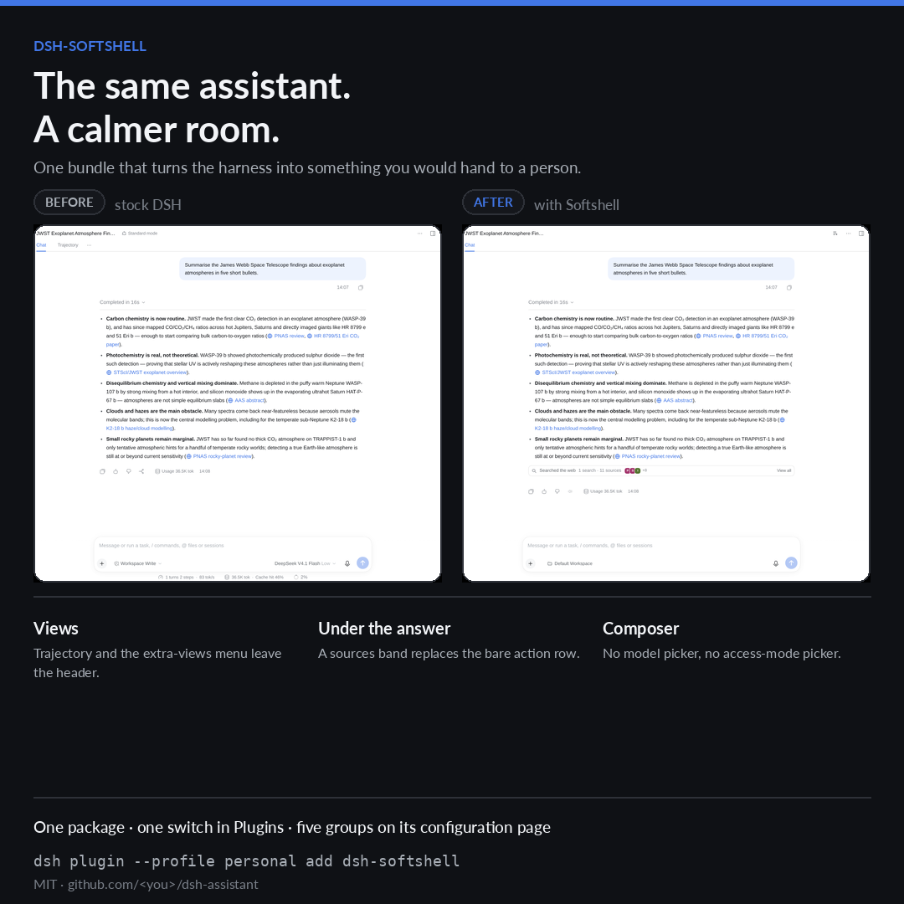
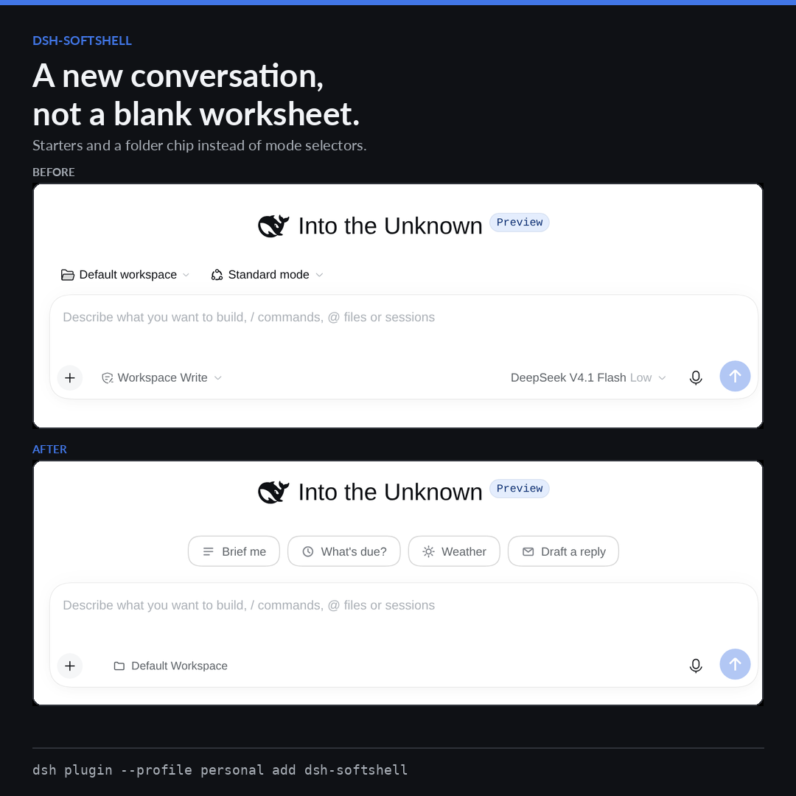

# Softshell

A personal surface for [DeepSeek Harness](https://github.com/deepseek-ai/deepseek-harness): it takes the developer chrome out of the conversation and gives the assistant a room you would hand to a person.





It is **one plugin**, one switch in the Plugins page, and it only changes what the conversation looks like. The agent, its tools, and its permissions are untouched — switching Softshell off restores stock DSH.

## What it changes

- **Declutter** — the Trajectory view and extra-views menu, the model picker, the access-mode picker, the agent-preset label, the turn/token/cache pills, the context meter, the branch action, and the per-turn "Edited N files" card leave the conversation.
- **Home** — four everyday starters (brief me, what's due, weather, draft a reply) on a new conversation instead of the coding empty state, with the workspace folder beside the attach control.
- **Sources** — web work reads like a briefing: a per-turn sources band under the answer, an inline "read N pages" row, and a **Sources** pane with titled cards that open in the sidebar browser.
- **Voice** — a speaker on every finished answer, using the device's own speech engine. No key, no network; when a device has no voices the control says so.
- **Ambient** — one "Right now" line in the prompt with the local time, and your place once you set it, plus `ambient_place` and `ambient_weather` (Open-Meteo, no key).

Every group is described on the bundle's page in Plugins. Per-item switches arrive in 0.2; today the whole pack is one switch.

## Install

```sh
dsh plugin --profile <profile> add github:RegeneratusLabs/dsh-softshell
```

Then open **Plugins**, find **Softshell** under Installed plugins, and switch it on. A published npm package (`dsh plugin --profile <profile> add dsh-softshell`) is planned; the git spec above works today, as does a local checkout:

```sh
dsh plugin --profile <profile> add ./dsh-softshell
```

### Optional settings

The row carries the ambient configuration. A profile's own patch layer may override it by id:

```yaml
- id: softshell
  config:
    place: Testville            # unset by default: no place line until you set one
    region: Example Region
    timeZone: Europe/Berlin     # IANA name
    units: metric               # metric | imperial
    includeClock: false         # true = show the clock even with no place
    weather: true               # false = register ambient_place only
```

The stored profile lives in `$DSH_HOME/ambient/profile.json` (0700/0600) and is normally written through `ambient_place`, which overrides the fields above for anything it has stored.

## Requirements

- DeepSeek Harness **0.2.2-rc.2** (tested). Softshell's declutter layer is built on the host's slot cells and semantic labels, so a later DSH that renames a control brings that control back rather than breaking the page. Nothing here patches DSH.
- Node 24+ to run the tests; the Web client half is plain JavaScript, no build step.

## How it works

Softshell is one package with a small host half (ambient) and one Web client artifact. On the client it replaces named slot cells with empty occupants (the edited-files card, the agent-preset label, the performance pills), adds its own seats (starters, workspace chip, sources pane and rows, read-aloud, bundle configuration page), and hides the few host-drawn controls that no slot exposes by a semantic attribute. It ships its own theme-token styles, requires only `react` from the host, and registers everything through `ctx.slots`, so disabling the bundle removes every change.

## Tests

```sh
npm test
```

The suite loads the real client artifact in a Node VM, proves each surface's logic survived the merge, mounts it against a fake Cordis context and asserts all thirteen seats, then runs the host half's ambient/place suite. No DSH process, no profile, no network.

## License

MIT.
